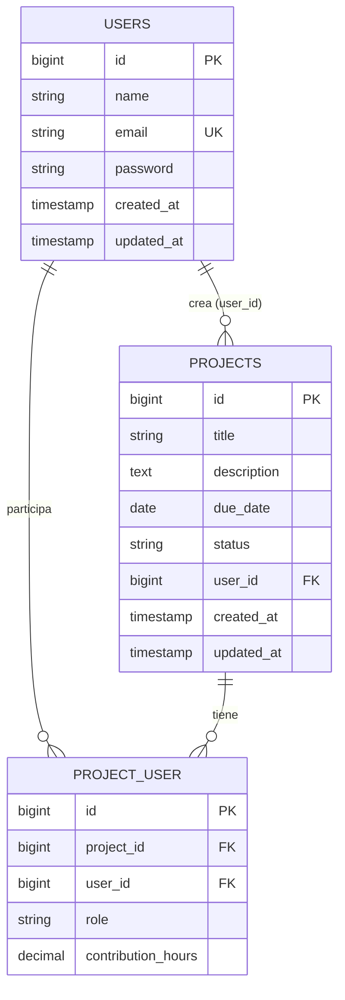

# Práctica final 2-9 · Gestor de proyectos colaborativo

Aplicación web desarrollada con **Laravel 13** para gestionar proyectos y los equipos que trabajan en ellos. Cada usuario registrado puede crear proyectos, convertirse en su propietario, añadir a otros usuarios como participantes (con un **rol** y unas **horas de contribución**) y consultar el estado de todos los proyectos desde un tablón.

Es una práctica del módulo de Desarrollo Web en Entorno Servidor (DWES). La aplicación es de tipo **SSR / MPA** (*Server-Side Rendering / Multi-Page Application*): todo el HTML se genera en el servidor con plantillas **Blade**, sin framework JavaScript en el cliente (solo Alpine.js para el menú desplegable de Breeze).

---

## Índice

1. [Descripción general](#1-descripción-general)
2. [Requisitos de la práctica y cómo se cumplen](#2-requisitos-de-la-práctica-y-cómo-se-cumplen)
3. [Tecnologías utilizadas](#3-tecnologías-utilizadas)
4. [Arquitectura y estructura del proyecto](#4-arquitectura-y-estructura-del-proyecto)
5. [Modelo de datos](#5-modelo-de-datos)
6. [Modelos Eloquent y relaciones](#6-modelos-eloquent-y-relaciones)
7. [Rutas](#7-rutas)
8. [Controladores](#8-controladores)
9. [Autenticación y autorización](#9-autenticación-y-autorización)
10. [Validación de datos](#10-validación-de-datos)
11. [Vistas y diseño](#11-vistas-y-diseño)
12. [Seeders y datos de prueba](#12-seeders-y-datos-de-prueba)
13. [Instalación y puesta en marcha](#13-instalación-y-puesta-en-marcha)
14. [Guía de uso y casos de prueba](#14-guía-de-uso-y-casos-de-prueba)
15. [Decisiones de diseño](#15-decisiones-de-diseño)
16. [Pruebas automáticas](#16-pruebas-automáticas)
17. [Limitaciones y posibles mejoras](#17-limitaciones-y-posibles-mejoras)
18. [Comandos útiles](#18-comandos-útiles)

---

## 1. Descripción general

La aplicación gira en torno a dos entidades: **usuarios** y **proyectos**.

- Un visitante sin sesión ve una **landing page** que le invita a registrarse o iniciar sesión.
- Un usuario autenticado accede a un **dashboard** y a un **tablón de proyectos** con tarjetas de colores según el estado de cada proyecto.
- Cualquier usuario autenticado puede **crear** proyectos y **consultar** el detalle de cualquiera de ellos.
- Solo el **propietario** de un proyecto puede **editarlo**, **eliminarlo** y **gestionar a sus participantes**.
- Dentro del detalle de un proyecto, el propietario añade a otros usuarios indicando su **rol** (Desarrollador, Diseñador, Tester...) y puede anotar y corregir las **horas trabajadas** de cada uno. La tabla muestra el total de horas del proyecto.

---

## 2. Requisitos de la práctica y cómo se cumplen

| Requisito del enunciado | Cómo se cumple |
|---|---|
| Aplicación SSR/MPA con vistas Blade | Todas las vistas son plantillas Blade (`resources/views`). No hay API ni SPA. |
| Entidad **Users** con autenticación | Laravel Breeze (stack Blade): registro, login, logout, recuperación de contraseña y perfil. |
| Entidad **Projects** con título, descripción, fecha límite y estado | Tabla `projects` (`title`, `description`, `due_date`, `status`). |
| Relación **1:N** Projects ↔ Users (propietario) | Clave foránea `projects.user_id`. Métodos `Project::owner()` y `User::projects()`. |
| Relación **N:N** Projects ↔ Users con pivote que incluye `role` y `contribution_hours` | Tabla `project_user` con `role` y `contribution_hours`. Métodos `Project::participants()` y `User::participatingProjects()` con `withPivot()`. |
| Solo usuarios logueados pueden ver y crear proyectos | Todas las rutas de proyectos están dentro del grupo con middleware `auth`. |
| CRUD completo de proyectos | `Route::resource('projects', ProjectController::class)`: listar, ver, crear, editar y eliminar. |
| Solo el propietario edita o borra (autorización) | Método privado `authorizeOwner()` en los controladores, que responde con **403** a cualquier otro usuario. |
| Gestión de participantes desde el detalle del proyecto | Formulario de alta (`add_participant.blade.php`) y filas editables en `show.blade.php`, procesados por `ProjectParticipantController` con `attach()`, `updateExistingPivot()` y `detach()`. |
| Diseño visual cuidado con Tailwind | Tarjetas, etiquetas de estado, formularios, tablas y botones con Tailwind CSS. |
| Landing page para usuarios no logueados | `welcome.blade.php`, con invitación a registrarse. |
| Uso de seeders para datos de prueba | `UserSeeder` y `ProjectSeeder`, lanzados desde `DatabaseSeeder`. |

---

## 3. Tecnologías utilizadas

| Tecnología | Versión / detalle | Uso |
|---|---|---|
| **PHP** | `^8.3` (el contenedor de Sail usa PHP 8.5) | Lenguaje del servidor |
| **Laravel** | `^13.17` | Framework MVC |
| **Laravel Breeze** | `^2.4` (stack Blade) | Autenticación y perfil de usuario |
| **Laravel Sail** | `^1.69` | Entorno de desarrollo con Docker |
| **MySQL** | 8.4 (contenedor de Sail) | Base de datos |
| **Eloquent ORM** | Incluido en Laravel | Acceso a datos y relaciones |
| **Blade** | Incluido en Laravel | Motor de plantillas |
| **Tailwind CSS** | v3, con el plugin `@tailwindcss/forms` | Estilos |
| **Vite** | `^8` con `laravel-vite-plugin` | Compilación de CSS y JS |
| **Alpine.js** | `^3.4` | Interactividad mínima (menú desplegable de Breeze) |
| **Pest** | `^5.3` | Pruebas automáticas |
| **Laravel Pint** | `^1.27` | Formato de código |

---

## 4. Arquitectura y estructura del proyecto

La aplicación sigue el patrón **MVC** (Modelo-Vista-Controlador):

- **Modelo** (`app/Models`): `User` y `Project`. Representan las tablas y sus relaciones mediante Eloquent.
- **Vista** (`resources/views`): plantillas Blade que presentan los datos.
- **Controlador** (`app/Http/Controllers`): reciben las peticiones, validan, consultan los modelos y devuelven una vista o una redirección.

### Estructura de directorios (solo lo relevante)

```text
.
├── app/
│   ├── Http/
│   │   ├── Controllers/
│   │   │   ├── Auth/                          # Controladores de Breeze (login, registro...)
│   │   │   ├── ProfileController.php          # Perfil de usuario (Breeze)
│   │   │   ├── ProjectController.php          # CRUD de proyectos
│   │   │   └── ProjectParticipantController.php  # Gestión de participantes (N:N)
│   │   └── Requests/                          # Form Requests de Breeze
│   ├── Models/
│   │   ├── Project.php
│   │   └── User.php
│   └── View/Components/                       # AppLayout y GuestLayout (Breeze)
├── database/
│   ├── migrations/
│   │   ├── 0001_01_01_000000_create_users_table.php   # users, password_reset_tokens, sessions
│   │   ├── 2026_11_09_110343_create_projects_table.php
│   │   └── 2026_11_09_111047_create_project_user_table.php
│   └── seeders/
│       ├── DatabaseSeeder.php
│       ├── UserSeeder.php
│       └── ProjectSeeder.php
├── resources/
│   ├── css/app.css                            # Directivas de Tailwind
│   ├── js/app.js                              # Alpine.js
│   └── views/
│       ├── welcome.blade.php                  # Landing page
│       ├── dashboard.blade.php
│       ├── layouts/                           # app, guest y navigation
│       ├── components/                        # Componentes Blade de Breeze
│       ├── auth/                              # Login, registro, etc. (Breeze)
│       ├── profile/                           # Edición de perfil (Breeze)
│       └── projects/
│           ├── index.blade.php                # Tablón de proyectos
│           ├── create.blade.php
│           ├── edit.blade.php
│           ├── show.blade.php                 # Detalle y participantes
│           └── add_participant.blade.php      # Subvista: formulario de alta de participante
├── routes/
│   ├── web.php                                # Rutas de la aplicación
│   └── auth.php                               # Rutas de autenticación (Breeze)
├── tests/                                     # Pruebas con Pest (las de Breeze)
├── compose.yaml                               # Servicios Docker de Sail (app + MySQL)
├── tailwind.config.js
└── vite.config.js
```

---

## 5. Modelo de datos

### Diagrama entidad-relación



### Tabla `projects`

| Columna | Tipo | Restricciones | Descripción |
|---|---|---|---|
| `id` | BIGINT UNSIGNED | PK, autoincremental | Identificador |
| `title` | VARCHAR(100) | NOT NULL | Título del proyecto |
| `description` | TEXT | NULL | Descripción (opcional) |
| `due_date` | DATE | NOT NULL | Fecha límite |
| `status` | VARCHAR(20) | NOT NULL, por defecto `pendiente` | `pendiente`, `en curso` o `finalizado` |
| `user_id` | BIGINT UNSIGNED | FK → `users.id`, `ON DELETE CASCADE` | Propietario (relación 1:N) |
| `created_at`, `updated_at` | TIMESTAMP | NULL | Marcas de tiempo de Eloquent |

### Tabla pivote `project_user` (relación N:N)

| Columna | Tipo | Restricciones | Descripción |
|---|---|---|---|
| `id` | BIGINT UNSIGNED | PK, autoincremental | Identificador de la participación |
| `project_id` | BIGINT UNSIGNED | FK → `projects.id`, `ON DELETE CASCADE` | Proyecto |
| `user_id` | BIGINT UNSIGNED | FK → `users.id`, `ON DELETE CASCADE` | Usuario participante |
| `role` | VARCHAR(50) | NOT NULL | Rol del usuario en el proyecto |
| `contribution_hours` | DECIMAL(6,2) | NOT NULL, por defecto `0` | Horas trabajadas |
| — | — | `UNIQUE (project_id, user_id)` | Un usuario no puede estar dos veces en el mismo proyecto |

El nombre `project_user` sigue la convención de Eloquent para tablas pivote: nombres de los dos modelos en singular y en orden alfabético. Gracias a ello no hace falta indicarlo en `belongsToMany()`.

### Otras tablas

Las migraciones de Laravel crean además `password_reset_tokens` y `sessions` (junto con `users`), `cache` y `jobs`. El driver de sesión es `database`, así que las sesiones viven en la tabla `sessions`.

---

## 6. Modelos Eloquent y relaciones

### `Project` (`app/Models/Project.php`)

```php
protected $fillable = ['title', 'description', 'due_date', 'status'];

public function owner()        // 1:N (lado "N"): propietario del proyecto
{
    return $this->belongsTo(User::class, 'user_id');
}

public function participants() // N:N: usuarios participantes
{
    return $this->belongsToMany(User::class)
                ->withPivot('role', 'contribution_hours');
}
```

- `user_id` **no** está en `$fillable` a propósito: el propietario nunca se decide desde un formulario, sino desde el servidor (ver [Decisiones de diseño](#15-decisiones-de-diseño)).
- `owner()` indica la clave foránea `user_id` porque Eloquent, por convención, buscaría `owner_id` al llamarse el método `owner`.
- `withPivot()` permite leer `role` y `contribution_hours` con `$participante->pivot->role`.

### `User` (`app/Models/User.php`)

```php
public function projects()              // 1:N (lado "1"): proyectos que ha creado
{
    return $this->hasMany(Project::class);
}

public function participatingProjects() // N:N: proyectos en los que participa
{
    return $this->belongsToMany(Project::class)
                ->withPivot('role', 'contribution_hours');
}
```

El modelo conserva lo que genera Breeze (`#[Fillable]`, `#[Hidden]` y el cast `password => hashed`).

---

## 7. Rutas

Definidas en `routes/web.php`. Las de autenticación están en `routes/auth.php` (Breeze).

### Públicas

| Método | URI | Nombre | Descripción |
|---|---|---|---|
| GET | `/` | — | Landing page (`welcome`) |
| GET | `/login`, `/register`, `/forgot-password`, `/reset-password/{token}`... | — | Rutas de Breeze (`routes/auth.php`) |
| GET | `/up` | — | Comprobación de salud de Laravel |

### Protegidas (middleware `auth`)

| Método | URI | Nombre | Acción |
|---|---|---|---|
| GET | `/dashboard` | `dashboard` | Dashboard (con `auth` y `verified`) |
| GET | `/profile` | `profile.edit` | Editar perfil |
| PATCH | `/profile` | `profile.update` | Guardar perfil |
| DELETE | `/profile` | `profile.destroy` | Eliminar cuenta |
| GET | `/projects` | `projects.index` | `ProjectController@index` |
| GET | `/projects/create` | `projects.create` | `ProjectController@create` |
| POST | `/projects` | `projects.store` | `ProjectController@store` |
| GET | `/projects/{project}` | `projects.show` | `ProjectController@show` |
| GET | `/projects/{project}/edit` | `projects.edit` | `ProjectController@edit` |
| PUT/PATCH | `/projects/{project}` | `projects.update` | `ProjectController@update` |
| DELETE | `/projects/{project}` | `projects.destroy` | `ProjectController@destroy` |
| POST | `/projects/{project}/participants` | `projects.participants.store` | `ProjectParticipantController@store` |
| PUT/PATCH | `/projects/{project}/participants/{participant}` | `projects.participants.update` | `ProjectParticipantController@update` |
| DELETE | `/projects/{project}/participants/{participant}` | `projects.participants.destroy` | `ProjectParticipantController@destroy` |

```php
Route::middleware('auth')->group(function () {
    // CRUD de proyectos (7 rutas REST)
    Route::resource('projects', ProjectController::class);

    // Gestión de participantes (N:N): añadir, modificar rol/horas y quitar
    Route::resource('projects.participants', ProjectParticipantController::class)
         ->only(['store', 'update', 'destroy']);
});
```

- `projects.participants` es un **recurso anidado**: el participante "vive" dentro de un proyecto.
- `->only([...])` registra solo las tres rutas que existen en el controlador.
- Los formularios HTML solo soportan GET y POST. Para `PUT` y `DELETE` se usa la directiva `@method('PUT')` / `@method('DELETE')`, que Laravel convierte mediante un campo oculto.

Para ver todas las rutas registradas:

```bash
./vendor/bin/sail artisan route:list
```

---

## 8. Controladores

### `ProjectController`

| Método | Qué hace |
|---|---|
| `index()` | Lista todos los proyectos: `Project::with('owner')->withCount('participants')->latest()->get()`. El *eager loading* (`with`) evita una consulta por cada tarjeta y `withCount` calcula el número de participantes en la misma consulta. |
| `create()` | Muestra el formulario de nuevo proyecto. |
| `store()` | Valida, crea el proyecto **a través de la relación** (`Auth::user()->projects()->create(...)`, que rellena `user_id`) y redirige al detalle con un mensaje flash. |
| `show()` | Carga el proyecto con su propietario y participantes (`with(['owner','participants'])`) y calcula `$availableUsers`: todos los usuarios salvo el propietario y los que ya participan, para el desplegable del formulario de alta. |
| `edit()` | Comprueba que eres el propietario y muestra el formulario con los datos actuales. |
| `update()` | Comprueba la propiedad, valida y actualiza. |
| `destroy()` | Comprueba la propiedad y elimina el proyecto (las filas de la pivote se borran por `ON DELETE CASCADE`). |
| `validationRules()` *(privado)* | Reglas compartidas por `store()` y `update()`. |
| `authorizeOwner()` *(privado)* | `abort_if($project->user_id !== Auth::id(), 403, ...)`. |

Se usa `findOrFail($id)` en todos los métodos: si el proyecto no existe, Laravel devuelve un **404**.

### `ProjectParticipantController`

| Método | Qué hace |
|---|---|
| `store()` | Añade un participante con `attach($userId, ['role' => ..., 'contribution_hours' => ...])`. Antes comprueba que el usuario existe, que no es el propietario y que no participa ya. |
| `update()` | Modifica rol y horas de **un** participante con `updateExistingPivot()`. Verifica antes que ese usuario participa en el proyecto (`findOrFail` sobre la relación, 404 si no). |
| `destroy()` | Quita al usuario del proyecto con `detach()`. Solo elimina la fila de la pivote: el usuario no se borra. |
| `authorizeOwner()` *(privado)* | Igual que en `ProjectController`. Se llama al principio de **cada** método. |

---

## 9. Autenticación y autorización

Son dos conceptos distintos:

- **Autenticación** (*¿quién eres?*): la resuelve **Laravel Breeze** con login, registro, recuperación de contraseña, confirmación de contraseña y gestión del perfil. El middleware `auth` redirige al login a quien intente entrar en una ruta protegida sin sesión.
- **Autorización** (*¿qué puedes hacer?*): la resuelve el método `authorizeOwner()` de los controladores. Si el usuario logueado no es el propietario, se aborta con un **403**.

### Quién puede hacer qué

| Acción | Visitante | Usuario logueado | Propietario del proyecto |
|---|:---:|:---:|:---:|
| Ver la landing | Sí | Sí | Sí |
| Ver el tablón y el detalle de proyectos | No (login) | Sí | Sí |
| Crear proyectos | No (login) | Sí | Sí |
| Editar o eliminar un proyecto | No (login) | No (403) | **Sí** |
| Añadir, modificar o quitar participantes | No (login) | No (403) | **Sí** |

### Protección en dos niveles

1. **En la vista:** los botones de editar, eliminar y el formulario de participantes solo se muestran al propietario (`@if ($isOwner)`, con `$isOwner = Auth::id() === $project->user_id`). Es una cuestión de experiencia de usuario.
2. **En el controlador:** `authorizeOwner()` comprueba la propiedad aunque el usuario escriba la URL a mano (por ejemplo `/projects/3/edit`). **Esta es la protección real**: ocultar un botón no impide una petición manual.

---

## 10. Validación de datos

La validación se hace en el servidor con `$request->validate()`. En los formularios HTML se añaden también `required`, `maxlength`, `min` y `step` como primera barrera en el cliente.

### Proyectos (`ProjectController`)

| Campo | Reglas |
|---|---|
| `title` | `required\|max:100` |
| `description` | `nullable` |
| `due_date` | `required\|date` |
| `status` | `required\|in:pendiente,en curso,finalizado` |

### Alta de participante (`ProjectParticipantController@store`)

| Campo | Reglas |
|---|---|
| `user_id` | `required\|exists:users,id` |
| `role` | `required\|max:50` |
| `contribution_hours` | `nullable\|numeric\|min:0` (si se deja vacío se guarda `0`) |

Además hay dos comprobaciones propias con mensaje de error: *"El propietario ya forma parte del proyecto"* y *"Este usuario ya participa en el proyecto"*.

### Modificación de participante (`ProjectParticipantController@update`)

| Campo | Reglas |
|---|---|
| `role` | `required\|max:50` |
| `contribution_hours` | `required\|numeric\|min:0` |

Usa `validateWithBag('participantUpdate', ...)`, una **bolsa de errores propia**, para que los errores de modificar una fila no aparezcan duplicados bajo los campos del formulario de añadir (que tiene campos con los mismos nombres).

### Repoblado de formularios y errores

Los formularios usan `old('campo')` para conservar lo que el usuario escribió cuando la validación falla, `@error('campo')` para mostrar el mensaje bajo cada campo y `$errors->has('campo')` para marcar el campo en rojo.

---

## 11. Vistas y diseño

Todas las vistas de la aplicación usan el layout de Breeze mediante el componente `<x-app-layout>` (con `<x-slot name="header">` para la cabecera). La landing usa su propio documento HTML, porque no hay usuario logueado.

### Vistas propias

| Vista | Descripción |
|---|---|
| `welcome.blade.php` | **Landing page** para visitantes: barra superior con login y registro, sección principal con vista previa de un proyecto, tres tarjetas de características, banner final de registro (solo con `@guest`) y pie. A un usuario logueado le ofrece ir al dashboard y a los proyectos (`@auth`). |
| `dashboard.blade.php` | Banner de bienvenida con avatar e inicial, botón **Ver proyectos** (acceso al tablón) y accesos rápidos a *Nuevo proyecto* y *Mi perfil*. |
| `projects/index.blade.php` | **Tablón de proyectos**: tarjetas en rejilla de 1, 2 o 3 columnas con franja de color según el estado, etiqueta de estado, descripción resumida, avatar del propietario ("Tú" si lo eres), fecha límite (en rojo con "Vencido" si ya pasó y el proyecto no está finalizado) y número de participantes. Incluye un estado vacío si no hay proyectos. |
| `projects/create.blade.php` | Formulario de nuevo proyecto: campos obligatorios marcados, ayudas, campos con error en rojo y aviso general. |
| `projects/edit.blade.php` | El mismo diseño con los datos actuales y `@method('PUT')`. |
| `projects/show.blade.php` | **Detalle del proyecto**: tarjeta con el resumen (propietario, fecha, número de participantes y horas totales), acciones del propietario y tabla de participantes. Para el propietario, cada fila tiene campos editables de rol y horas y botones *Guardar* y *Quitar*; el resto de usuarios ve la tabla en solo lectura. |
| `projects/add_participant.blade.php` | Subvista incluida desde `show` (`@include('projects.add_participant')`) solo para el propietario: desplegable de usuarios disponibles, rol (campo de texto con sugerencias) y horas. |

### Vistas de Breeze

`auth/*` (login, registro, recuperación y confirmación de contraseña), `profile/*` (datos, contraseña y borrado de cuenta), `layouts/app`, `layouts/guest`, `layouts/navigation` (donde se añadió el enlace **Proyectos**, tanto en el menú de escritorio como en el móvil) y los componentes Blade de `components/`.

### Diseño con Tailwind CSS

- **Paleta:** blanco, grises y un único color de acento (**índigo**) para botones y enlaces. Rojo solo para acciones destructivas y errores.
- **Estados con color:** `pendiente` en amarillo, `en curso` en azul y `finalizado` en verde. Cada estado define el color de la etiqueta, del punto y de la franja superior de la tarjeta.
- **Tarjetas** con borde, sombra suave y elevación al pasar el ratón; **tablas** con cabeceras diferenciadas y filas que se resaltan; **formularios** con etiquetas, ayudas y mensajes de error.
- **Responsive:** las rejillas cambian de 1 a 2 o 3 columnas (`md:`, `lg:`) y las tablas tienen scroll horizontal en pantallas pequeñas.
- Tema **solo claro**.
- Se evitan los iconos de librerías externas: son SVG incrustados.

### Detalles de Blade que conviene conocer

- `@forelse ... @empty` para tratar listas vacías.
- `session('success')` muestra los mensajes *flash* que envían los controladores con `->with('success', ...)`.
- `@selected(...)` marca la opción activa de un `<select>`.
- En `show.blade.php`, los campos de rol y horas de cada fila usan el atributo HTML `form="update-ID"` para asociarse al formulario de esa fila, porque HTML no permite anidar un `<form>` dentro de otro y la tabla necesita dos formularios (modificar y quitar) por fila.
- Las fechas se formatean con `\Carbon\Carbon::parse($project->due_date)->format('d/m/Y')`, porque el modelo no define un *cast* para `due_date`.

---

## 12. Seeders y datos de prueba

`DatabaseSeeder` llama, en este orden, a `UserSeeder` y `ProjectSeeder`. **El orden importa**: los proyectos necesitan que los usuarios ya existan.

### Usuarios (contraseña de todos: `password`)

| Nombre | Email |
|---|---|
| Ana García | `ana@example.com` |
| Luis Martínez | `luis@example.com` |
| Marta López | `marta@example.com` |
| Pablo Ruiz | `pablo@example.com` |

### Proyectos

| Proyecto | Propietario | Estado | Fecha límite | Participantes (rol · horas) |
|---|---|---|---|---|
| Rediseño de la web corporativa | Ana | En curso | 15/12/2026 | Luis (Desarrollador · 24,5), Marta (Diseñador · 18) |
| App móvil de reservas | Ana | Pendiente | 01/03/2027 | Pablo (Tester · 0) |
| API de facturación | Luis | En curso | 30/11/2026 | Ana (Desarrollador · 40), Pablo (Tester · 12,25) |
| Manual de identidad visual | Marta | Finalizado | 01/10/2026 | — |

Los datos están pensados para probar los distintos casos: propietarios diferentes, los tres estados, horas con y sin decimales, un proyecto sin participantes, un propietario que participa en un proyecto ajeno y una fecha límite pasada en un proyecto finalizado (que **no** se marca como vencido).

Los seeders usan **Eloquent** en lugar de `DB::table()->insert()`. Así la contraseña se cifra automáticamente (cast `hashed`), los timestamps se rellenan solos y se reutilizan las relaciones (`$ana->projects()->create(...)` y `attach()` con datos de la pivote).

---

## 13. Instalación y puesta en marcha

El proyecto está preparado para ejecutarse con **Laravel Sail** (Docker). Los comandos se muestran con `./vendor/bin/sail`; en Windows se recomienda usar **WSL 2** con Docker Desktop.

### Requisitos previos

- Docker y Docker Compose (Docker Desktop en Windows y macOS).
- Git.
- PHP y Composer en local son opcionales (ver el paso 2).

### Pasos

**1. Clonar el repositorio**

```bash
git clone <url-del-repositorio>
cd Practica_final_2-9
```

**2. Instalar las dependencias de PHP**

Con Composer instalado:

```bash
composer install
```

Sin PHP ni Composer en local, se puede usar un contenedor temporal (ajusta la versión de PHP de la imagen si hiciera falta):

```bash
docker run --rm -u "$(id -u):$(id -g)" -v "$(pwd):/var/www/html" -w /var/www/html \
    laravelsail/php85-composer:latest composer install --ignore-platform-reqs
```

**3. Crear y configurar el archivo `.env`**

```bash
cp .env.example .env
```

El `.env.example` viene configurado con **SQLite**. Para usar el MySQL de Sail, cambia el bloque de base de datos:

```dotenv
DB_CONNECTION=mysql
DB_HOST=mysql
DB_PORT=3306
DB_DATABASE=laravel
DB_USERNAME=sail
DB_PASSWORD=password
```

`DB_HOST=mysql` es el nombre del servicio en `compose.yaml`. Opcionalmente, cambia `APP_NAME` para cambiar el nombre que aparece en la landing y en la barra de navegación.

> El driver de sesión es `database` (`SESSION_DRIVER=database`). Si la base de datos no tiene las tablas, cualquier petición fallará con el error *"Table 'laravel.sessions' doesn't exist"*. Se soluciona con el paso 6.

**4. Levantar los contenedores**

```bash
./vendor/bin/sail up -d
```

Levanta la aplicación (puerto **80**), MySQL 8.4 (puerto 3308 en tu máquina) y expone el puerto de Vite (5173).

**5. Generar la clave de la aplicación**

```bash
./vendor/bin/sail artisan key:generate
```

**6. Crear las tablas y cargar los datos de prueba**

```bash
./vendor/bin/sail artisan migrate:fresh --seed
```

> `migrate:fresh` **borra todas las tablas** y las vuelve a crear. Úsalo solo en desarrollo.

**7. Instalar y compilar los recursos del frontend**

```bash
./vendor/bin/sail npm install
./vendor/bin/sail npm run dev      # desarrollo: deja este proceso en marcha
# o bien, una sola vez:
./vendor/bin/sail npm run build    # genera los estilos definitivos en public/build
```

**8. Abrir la aplicación**

Visita **http://localhost**. Para entrar con un usuario de prueba, usa `ana@example.com` y la contraseña `password`.

### Importante: Vite y Tailwind

Tailwind solo genera las clases que encuentra escritas en tus vistas **cuando Vite las compila**.

- Mientras desarrollas, deja `sail npm run dev` corriendo. Si se cierra, las vistas se verán sin estilos o con colores incorrectos.
- Si solo quieres ver la aplicación, ejecuta `sail npm run build` una vez: los estilos quedan en `public/build` y bastará con `sail up -d`.
- Si tras cerrar Vite de golpe la aplicación se queda sin estilos, borra el archivo `public/hot` y recarga con Ctrl+F5.

---

## 14. Guía de uso y casos de prueba

### Recorrido básico

1. Entra en `http://localhost` sin sesión: verás la **landing page**.
2. Pulsa **Crear cuenta gratis** y regístrate, o inicia sesión con un usuario de prueba.
3. Desde el **dashboard**, pulsa **Ver proyectos** para abrir el tablón.
4. Crea un proyecto con **+ Nuevo proyecto**. Al guardar, irás a su detalle con un mensaje de confirmación.
5. En el detalle, usa **Añadir participante** para elegir un usuario, indicar su rol y sus horas.
6. En la tabla de participantes, modifica rol u horas y pulsa **Guardar**, o pulsa **Quitar** para sacar al usuario del proyecto.

### Casos de prueba recomendados

| Caso | Resultado esperado |
|---|---|
| Entrar en `/projects` sin sesión | Redirección al login |
| Como Ana, abrir "Rediseño de la web corporativa" | Ve los botones de editar y eliminar, la tabla editable y el formulario de alta |
| Como Luis, abrir ese mismo proyecto | Solo lectura: sin botones ni formulario |
| Como Luis, abrir `/projects/1/edit` (proyecto de Ana) | Error **403** |
| Crear un proyecto con el título vacío (sin `required` en el navegador) | Aviso general, campo en rojo y datos conservados |
| Añadir a un usuario que ya participa | Mensaje "Este usuario ya participa en el proyecto" |
| Modificar las horas de un participante a un valor negativo | Recuadro de error sobre la tabla |
| Quitar un participante y volver a añadirlo | Vuelve a aparecer en el desplegable y se puede añadir de nuevo |
| Eliminar un proyecto con participantes | Se borra el proyecto y sus participaciones (cascada), los usuarios se conservan |
| Cambiar a un proyecto pendiente una fecha de ayer | En el tablón aparece la fecha en rojo con "Vencido" |
| Abrir `/projects/999` | Error **404** |

---

## 15. Decisiones de diseño

**`user_id` fuera de `$fillable`.** Si `user_id` fuese asignable en masa, cualquier usuario podría enviar un campo manipulado y crear proyectos a nombre de otro. El proyecto se crea mediante la relación (`Auth::user()->projects()->create(...)`), que asigna el propietario automáticamente.

**`validate()` en lugar de `$request->all()`.** `validate()` devuelve solo los campos validados, así que nunca llegan al modelo datos que no se hayan comprobado.

**`attach()`, `updateExistingPivot()` y `detach()`, y no `sync()`.** `sync($ids)` deja en la relación solo los ids que se le pasan y **elimina al resto**. Como aquí se edita a una persona cada vez, usar `sync()` con un único id borraría a todos los demás participantes. `updateExistingPivot()` modifica los datos de la pivote de un solo participante.

**Pivote con `UNIQUE(project_id, user_id)`.** Garantiza a nivel de base de datos que un usuario no esté dos veces en un proyecto. El controlador además lo comprueba antes para mostrar un mensaje claro en vez de un error 500.

**`ON DELETE CASCADE`.** Si se elimina un usuario se eliminan sus proyectos (un proyecto sin propietario no tiene sentido) y sus participaciones; si se elimina un proyecto, se eliminan sus participaciones. Los apuntes recomiendan usarlo con cuidado: aquí se justifica por la integridad de los datos.

**Autorización en el controlador y no solo en la vista.** Los botones ocultos son solo comodidad; la comprobación `authorizeOwner()` protege de verdad frente a peticiones manuales.

**Bolsa de errores `participantUpdate`.** Evita que un error al modificar un participante se muestre también en el formulario de alta, que comparte nombres de campo (`role`, `contribution_hours`).

**Atributo `form="..."` en las filas editables.** Permite tener dos formularios por fila (modificar y quitar) sin anidar `<form>`, algo que HTML no permite.

**Consultas en el controlador, no en la vista.** Los usuarios disponibles (`$availableUsers`), el número de participantes (`withCount`) y las relaciones precargadas (`with`) se preparan en el controlador (MVC). La vista solo presenta los datos.

**`with()` y `withCount()` (eager loading).** Evitan el problema de las N+1 consultas en el tablón y en el detalle.

**Subvista `add_participant`.** El formulario de alta se aísla en su propia vista y se incluye con `@include` dentro del detalle. Sigue estando "dentro de la vista detalle", como pide el enunciado, y evita crear una ruta y un método extra solo para mostrar el formulario.

**Recursos anidados (`projects.participants`).** Reflejan que un participante pertenece a un proyecto y generan URLs claras (`/projects/{project}/participants/{participant}`).

**Fechas sin `cast`.** `due_date` llega como texto `AAAA-MM-DD`, que es justo el formato que espera `<input type="date">`. Para mostrarla en formato español se usa Carbon en las vistas.

---

## 16. Pruebas automáticas

El proyecto incluye **Pest** y las pruebas que genera Laravel Breeze (autenticación, registro, recuperación y confirmación de contraseña, verificación de correo y perfil), en `tests/Feature`.

```bash
./vendor/bin/sail artisan test
```

Las pruebas usan `RefreshDatabase`, por lo que reconstruyen la base de datos de pruebas en cada ejecución.

> **Aún no hay pruebas específicas** para el CRUD de proyectos ni para la gestión de participantes. Es una de las mejoras pendientes (ver el apartado siguiente).

---

## 17. Limitaciones y posibles mejoras

- **Pruebas:** añadir tests de feature con Pest para el CRUD de proyectos, la autorización (403) y la gestión de participantes.
- **Policies:** sustituir `authorizeOwner()` (duplicado en los dos controladores) por una *Policy* de Laravel, que centraliza la autorización.
- **Idioma:** `APP_LOCALE` es `en` por defecto, de modo que los mensajes de validación de Laravel se muestran en inglés. Se puede cambiar a `es` e incorporar los ficheros de idioma.
- **Zona horaria:** `config/app.php` usa `UTC`. Para fechas "de hoy" en España convendría `Europe/Madrid`.
- **Paginación y búsqueda:** el tablón carga todos los proyectos con `get()`. Con muchos datos convendría paginar y añadir filtros por estado.
- **Visibilidad de proyectos:** ahora cualquier usuario autenticado ve todos los proyectos (así lo pide el enunciado). Se podría limitar a los propios y a aquellos en los que se participa.
- **Estados como constantes:** los tres estados están repetidos (reglas de validación, selects y estilos). Podrían centralizarse en el modelo o en un *enum*.
- **Estilos de estado duplicados:** el array de colores se repite en `index.blade.php` y `show.blade.php`. Podría moverse a un método del modelo o a un componente Blade.
- **Cast de fecha:** definir `due_date` como fecha en el modelo permitiría usar `->format()` directamente en las vistas.
- **Verificación de correo:** el modelo `User` no implementa `MustVerifyEmail`, por lo que no se exige verificar el correo.
- **Formularios duplicados:** `create` y `edit` comparten casi todo el HTML y podrían unificarse en una subvista.

---

## 18. Comandos útiles

```bash
# Contenedores
./vendor/bin/sail up -d                  # Levantar en segundo plano
./vendor/bin/sail down                   # Detener
./vendor/bin/sail shell                  # Terminal dentro del contenedor

# Base de datos
./vendor/bin/sail artisan migrate                  # Lanzar migraciones pendientes
./vendor/bin/sail artisan migrate:fresh --seed     # Recrear todo y cargar datos de prueba
./vendor/bin/sail artisan migrate:status           # Estado de las migraciones
./vendor/bin/sail mysql                            # Consola de MySQL

# Aplicación
./vendor/bin/sail artisan route:list     # Listar rutas
./vendor/bin/sail artisan route:clear    # Limpiar la caché de rutas
./vendor/bin/sail artisan view:clear     # Limpiar la caché de vistas
./vendor/bin/sail artisan tinker         # Consola interactiva

# Frontend
./vendor/bin/sail npm run dev            # Vite en modo desarrollo
./vendor/bin/sail npm run build          # Compilación definitiva

# Calidad
./vendor/bin/sail artisan test           # Pruebas
./vendor/bin/sail bin pint               # Formatear el código con Pint
```

---

## Licencia

Proyecto académico desarrollado sobre [Laravel](https://laravel.com), un framework de código abierto con licencia [MIT](https://opensource.org/licenses/MIT).